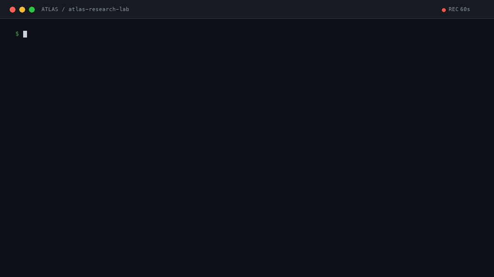

# ATLAS Research Lab



[](https://github.com/ali-han-kaya/atlas-research-lab/actions/workflows/dogrula.yml)

**A verification-first, multi-agent research lab.** A delivery is judged by fail-closed gates that run over its own bytes—never by a model's confidence.

[**Türkçe**](README.tr.md) · [**Language gateway**](README.md) · [**English quickstart**](docs/EN/QUICKSTART.md)

```console
$ ./demo
...
  bugunku mutabakat : FAIL  (fix_reconcile, rc=1)
...
HUKUM: FAIL — iddia 8, kanit 2; dondurulmus kapi PASS dedi.
BEKLENEN KIRMIZI — bu komut bilerek rc=1 doner.
```

**8/8 · 54/54 · 174/174**

**8/8** gate checks · prior mutation baseline · **174/174** KOD self-tests.

The mutation baseline above is historical. The current battery is **113/113** firing cases plus **28/28** expected findings over **117** verified rules: **93 firing-tested** and **24 expected-finding-only**; `make dogrula` reports **8/8**.

Gate scripts declare **121** identifiers. **117** of them are rules — **93** proven by a case that turns the gate red and **24** that only emit an expected marker — and **4** are dead identities that no code branch ever prints, plus **1** external decision reference. Zero rules are out of scope with a measured reason, and zero are unexplained gaps. The full per-rule table is generated from code: [`docs/KURAL-KATALOGU.md`](docs/KURAL-KATALOGU.md).

ATLAS ships the production mechanism itself — the academic audit and code pipelines, agents, templates, executable gates, self-tests and a mutation battery — and deliberately excludes the papers, corpora and session handoffs it produces. Its sharpest evidence is a frozen defective run (`DENEME/`): the fix manifest declared every fix applied while only a fraction reached the master text, and the gate of that day still said `PASS`; `./demo` reproduces that false `PASS` and returns a red verdict by design.

**Turkish documentation:** [`README.tr.md`](README.tr.md). The English file is the default entry; the Turkish file remains the complete canonical description.

## Quick start

Requirements: `python3` (3.9+), `make`, `git`. Verification needs no model calls, no network access and no API keys.

Install dependencies into an isolated `.venv` inside the repository, not into the system Python. `make` uses the active Python; if a required module is missing, `make dogrula` prints the isolated-venv setup commands before any checks run.

```bash
git clone https://github.com/ali-han-kaya/atlas-research-lab.git
cd atlas-research-lab
python3 -m venv .venv
. .venv/bin/activate
python -m pip install -r requirements-dev.txt   # pinned: requests, pip-audit, jsonschema
make kur                                         # enable commit/push guards in this clone
make dogrula
./demo                                           # expected: exit code 1 (red)
```

`./demo` is the canonical demo entry point. Its exit code is exactly **1** for the expected red and **2** for a broken fixture; a consistent fixture exits cleanly. `make demo` is only a thin wrapper: GNU make reports every failing recipe as **2**, so it cannot carry the 1-versus-2 distinction. Use `./demo` when the code matters.

## How a violation travels

A rule is only worth what its gate can prove. Every violation therefore has to
survive the same seven layers:

```text
1. gate scripts        ATLAS_SABLONLAR/scripts, KOD_SABLONLAR/scripts
                       each rule lives in one script; rc=1 (error) or rc=2 (terminal)
2. mutation battery    tools/mutasyon_bataryasi.py
                       clean baseline, one violation, undo; leakage + green-again checks
3. run evidence        tools/mutasyon_sonuc.json
                       per-case outcome of the last real run
4. scope               tools/kapsam.py
                       inventory, severity, evidence; ratchet on tested/gap counts
5. single entry gate   tools/dogrula.py
                       H1..H5 hygiene/secrets + T1..T3 self-tests; 8 checks, raw output
6. claim ledger        tools/iddia.py
                       every number printed in the docs is re-measured by running it
7. tree attestation    tools/kanit.py + attestation.json
                       commit/tree SHA-256, recomputed by the entry gate
```

Two properties matter more than the layer count. First, **evidence is a run,
not a definition**: coverage status is read from the last battery run, and the
battery's freshness is bound to the source SHA-256 of the gates — so editing a
gate invalidates the evidence instead of silently keeping it. Second, **every
case is checked for leakage and for reversibility**: only its own label may
fire, and undoing the violation must turn the gate green again. A case that
turns red for the wrong reason fails the battery.

## Scope ratchet

The historical baseline is **23**. The current allowance is **zero**. A new
rule must have a mutation case or a reasoned `KAPSAM_ISTISNA` entry; without
one, `make kapsam` and the CI step fail closed. A closed baseline rule may not
fall back to a gap, and the tested-rule count may not drop.

The generated [`docs/DURUM.md`](docs/DURUM.md) and
[`docs/MUTASYON_KAPSAM.md`](docs/MUTASYON_KAPSAM.md#kapsam-ratchet) pages are
the source of truth for the current counters and per-rule evidence; do not copy
those numbers into prose.

## What is measured

| Command | What it proves |
|---|---|
| `make dogrula` | One entry point for repository hygiene, syntax, secret scan and the self-test suites. It prints its own raw output; a check that does not run is printed as `CALISTIRILMADI` and is never counted as a pass. |
| `make mutasyon` | Every case starts with a silent clean baseline and injects one violation. Error cases must turn red (`rc=1`) with the expected marker; expected-finding cases must emit the expected warning/finding (`rc=0` is allowed). A finding present in the baseline fails the case. |
| `./demo` | Reproduces the frozen `DENEME/` contradiction: the manifest claims more fixes than the master text contains, while the frozen gate says `PASS`. The expected result is a red verdict. |
| `make iddia` | Re-measures the numeric claims printed in the public docs and requires each stored raw output line to match the current output **verbatim**. A mismatch is named by `IDD-*`. It does not change the `make dogrula` verdict. The whole line is stored, never just the numeric part; the only normalisation is the line's own variable provenance (`commit=<sha>` · `tree=<sha>`), so the `T1` evidence is the full `OZ-TEST: … KANIT commit=… tree=…` line. |
| `make kanit` / `make kanit-paket-dogrula` / `make makbuz-dogrula` | Produces and validates a portable package containing the commit/tree attestation, command exit codes, finding IDs, raw command logs and a SHA-256 manifest. `makbuz.json` binds each command's argv, exit code and raw output line to the commit/tree attestation; `make makbuz-dogrula` cross-checks it against the package logs and manifest. CI uploads it as the `atlas-kanit-paketi` artifact. |
| `tools/yayinla.py` | Publication parity: copies only an explicit allowlist from the private lab tree, refuses out-of-scope artefacts, scans for secrets and reports new/changed/deleted files. |

CI runs the runner form of the checks, the mutation battery, scope freshness, dependency audit and the demo assertion in `.github/workflows/dogrula.yml`.

## Honest limits

- **OLG-1 (`T1`) runs only against this tree's `attestation.json`.** `olgu_lint` verifies the real commit/tree evidence; there is no historical or private-tree fallback. `make dogrula` reports 8/8 and T1 is a pass. If the attestation is missing or corrupt, OLG-1 fails; it is not reported as not run.
- **The archive is out of scope.** Generated papers, corpora and session handoffs are deliberately not published. This repository is the mechanism; some historical documents cite handoff files that are not published here, but those citations are archive notes, not verification inputs.
- **Tests measure gate behaviour, not content truth.** They show that a gate fires on a known violation. They do not prove that the content is correct, and an empty test can still pass a gate; the layering reduces that risk but does not eliminate it.
- **`DENEME/` is frozen on purpose.** It is a deliberately defective run kept as a regression fixture. Do not "fix" it: the defect is the lesson.
- **Network checks are optional.** The live model-catalogue check needs network; a weekly non-required canary reports drift, but it is not part of the required CI verdict and is never required for the local battery.

## Read more

- [`README.tr.md`](README.tr.md) — complete Turkish documentation.
- [`docs/EN/QUICKSTART.md`](docs/EN/QUICKSTART.md) — longer English quickstart.
- [`docs/README.md`](docs/README.md) — published scope and exclusions.
- [`docs/KURAL-KATALOGU.md`](docs/KURAL-KATALOGU.md) — generated rule catalogue: every rule, its severity, what it checks, how it is proven, and the measured reason for each excluded identifier.
- [`docs/MUTASYON_KAPSAM.md`](docs/MUTASYON_KAPSAM.md) — which gate rules are mutation-tested, out of scope or still gaps.
