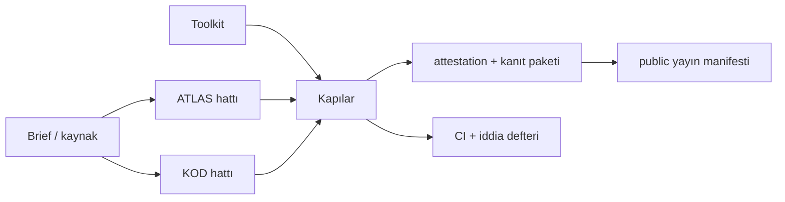

# ATLAS Research Lab

[English](README.en.md) · **Türkçe**

[](https://github.com/ali-han-kaya/atlas-research-lab/actions/workflows/dogrula.yml)

**A verification-first, multi-agent research lab.** ATLAS treats verification as the
product: a delivery is judged by gates that run over its own bytes, never by a model's
claim that the work was done.

> **Kısa tur:** [ATLAS'ı kısa turda anla](docs/ATLAS-KISA-TUR.md) — lab ne yapar,
> kime yarar, iddiasını nasıl kanıtlar. Depoyu ilk kez açan için başlangıç noktası.

## Kısa tur — üç soru, üç cevap

| Soru | Kısa cevap |
|---|---|
| **Bu lab ne yapar?** | Akademik metni ve yazılımı, modelin "tamamlandı" beyanına değil teslimin kendi baytları üzerinde koşan kapılara bağlar. Ürettiği makaleleri değil, üretim mekanizmasını yayımlar. |
| **Kime yarar?** | Araştırmacıya kaynak/iddia disiplini; yazılım ekibine kanıtlı teslim; denetçiye ve işe alım ekibine ölçülebilir süreç; yeni öğrenene çalışan örnekler. |
| **İddiasını nasıl kanıtlar?** | Her sayıyı üreten komuta, her teslimi commit/ağaç hash'ine, her kapıyı temiz taban + ihlal testine bağlar. Ölçülemeyen şey `OLCULMEYEN` kalır; `PASS` sayılmaz. |

## Mimari — tek bakışta



- **ATLAS hattı:** kapsam → paralel inceleme mercekleri → hedefli düzeltme → MASTER → çift hakem kabulü.
- **KOD hattı:** kapsam, tasarım, uygulama, kanıt ve bağımsız kapılar; teslimin tabanı zorunludur.
- **Toolkit:** model-agnostik oturum sözleşmesi ve çalıştırılabilir denetimler.
- **Kanıt katmanı:** `attestation.json` commit/ağaç/dosya hash'lerini; `make iddia` ise kamu belgelerindeki sayıları üreten komutlara bağlar.

### Bir brief'in izlediği yol

| Aşama | Gerçek giriş (bu depoda) | Üretilen / teslim edilen |
|---|---|---|
| Kapsam | `ATLAS_SABLONLAR/.opencode/command/atlas-faz0.md` · `ATLAS_SABLONLAR/.opencode/agent/atlas-scoper.md` | Hedef projede kapsam sözleşmesi; public sınır `docs/README.md` |
| Üç lens | `ATLAS_SABLONLAR/.opencode/command/atlas-faz1.md` · `atlas-lens-consistency.md` · `atlas-lens-structure.md` · `atlas-lens-editor.md` | Bağımsız bulgu listesi |
| Hedefli düzeltme | `ATLAS_SABLONLAR/.opencode/command/atlas-faz2.md` · `atlas-writer-master.md` | FIX manifesti ve değişen metin |
| MASTER + kapı | `ATLAS_SABLONLAR/.opencode/command/atlas-faz3.md` · `atlas-gate-2a.md` · `atlas-gate-2b.md` | MASTER sürümü; kabul/red kararı |
| Kanıt | `make dogrula` · `make iddia` · `./demo` · `make kanit-dogrula` | Ham komut çıktısı, `attestation.json`, `kanit-paketi/` |
| Public yayın | `tools/yayin_kapisi.py` · `tools/yayinla.py` | Yalnız manifestteki mekanizma; makale/çıktı arşivi değil |

KOD hattı aynı mantığı `KOD_SABLONLAR/00_KOD_OKU_BENI.md` → `kod-faz0` … `kod-teslim`
komutlarıyla yürütür; KOD'un zorunlu artefaktı taban (`BASELINE`) ve 2A/2B/2C
kapılarıdır. Yukarıdaki girişler gerçek dosyalardır; hedef projede kopyalanan
şablonlar bu depodaki mekanizmayı çağırır.

## Kapı ve test kapsamı — nerede?

| Katman | Giriş | Ne ölçer? |
|---|---|---|
| Tek giriş | `make dogrula` | Depo hijyeni, sözdizimi, sır taraması, kapı öz-testleri ve üç öz-test paketi |
| Sayısal iddia | `make iddia` | README ve kamu belgelerindeki sayıları, onları üreten komut ve ham çıktıyla |
| Kapı davranışı | `make mutasyon` | Temiz taban + tek ihlal + kırmızı hüküm; kuralların gerçekten ateşlediğini |
| Ağaç kanıtı | `make kanit-dogrula` | `attestation.json` içindeki commit, ağaç ve dosya hash'lerini |
| Yayın sınırı | `make yayin-kapisi` | Manifest, listelenmemiş dosya, makale izi, sır ve kişisel mutlak yol |
| Kod arama kanıtı | `make kamu-arama` | GitHub kod aramasında repo kapsamlı sorgular; yalnız `incomplete_results=false` olan sıfır sonuçlar kanıt; indeks gecikmesi `OLCULEMEDI` |
| Kırmızı demo | `./demo` | Bilerek kusurlu koşuda beklenen reddi; `make demo` değil, doğrudan `./demo` |

Güncel öz-test ve envanter sayıları üretilmiş [`docs/DURUM.md`](docs/DURUM.md)
dosyasındadır; README'ye elle sayı yazılmaz. Yayın kapısı `make dogrula`nın
**ön koşuludur**, sayılan sekiz kaleme eklenmez.

`make kamu-arama` GitHub kod aramasını repo kapsamında sorgular. Bir sıfır sonuç
yalnız `incomplete_results=false` ise kanıt sayılır; `incomplete_results=true` ise
sonuç `OLCULEMEDI INDEKS_YETISMEDI` olarak raporlanır ve **PASS sayılmaz**. Token
`GITHUB_TOKEN`/`GH_TOKEN` ortamından veya `gh auth token` üzerinden okunur; token
çıktıya yazılmaz. Ağsız sözleşme testi `make kamu-arama-selftest`tir. Kendi
sorgularınızı `python3 tools/kamu_lint.py --github-arama --sorgu '<metin>'` ile
verebilirsiniz. Bu kontrol ağ ve kimlik gerektirdiği için `make dogrula`nın
sekiz kalemine dahil değildir; canlı koşu ayrıca yapılır.

## Yayın sınırı

Bu depo **üretim mekanizmasıdır, ürün arşivi değildir.** Makale metinleri,
PDF'ler, konu korpusları, `projeler/` ve ham araştırma çıktıları public ağaca
girmez. Hangi dosyanın girdiği `tools/yayin_manifest.json` ile açıkça listelenir;
liste dışı dosya, sır, kişisel mutlak yol veya makale iskeleti `make yayin-kapisi`
tarafından fail-closed durdurulur. Ayrıntı ve ekleme prosedürü:
[Yayın sözleşmesi](docs/YAYIN-SOZLESMESI.md).

## In brief (English)

- **What it does.** Academic audit and hardening (scope → three parallel review lenses →
targeted fixes → master revision → 2-of-2 acceptance) and a code pipeline (KFAZ0–5 with a
mandatory baseline and 2A/2B/2C gates). Generated papers, corpora and session handoffs
are deliberately excluded — this repository is the mechanism, not the archive.
- **Which gates exist.** An eight-predicate revision gate (count drift, claim IDs,
body/title consistency, class scan, residue bucket, measurement freshness, version
marker, source level — all eight must be zero); a closed severity list P0/P1/P2 where any
unknown label becomes `SCHEMA_INVALID` → P0; KEEP fingerprints so silent deletion becomes
visible; evidence levels (`BIRINCIL`/`DIJITAL`/`BEYAN`/`OLCULMEDI`); fail-closed handling
(unmeasured is never a pass); and tamper detection (`GATE_TAMPERED` → P0).
- **How claims are verified.** `make dogrula` (hygiene, syntax, secret scan, secret-gate
self-test, three self-test suites), `make mutasyon` (ninety-three firing-tested gate rules,
each exercised by a 141-case battery: silent clean baseline + one violation + a red/terminal
verdict or expected finding), and `tools/yayinla.py`
(publish parity: 0 new / 0 changed / 0 deleted). The same commands run in CI on GitHub Actions.
`make iddia` closes the remaining gap: it re-measures the numbers printed in this README.
- **Reproduce it.** `./demo` prints the frozen 8-vs-2 failure with a **red verdict and
exit code 1** (fixture drift: 2; consistent fixture: 0). `make demo` is only a thin
wrapper and cannot carry 1 vs 2, because GNU make always exits 2 on a failing recipe. `make dogrula` → **8 pass / 0 fail / 0 not run** (T1, `OLG-1`, now
runs against this tree's `attestation.json`); current self-test and inventory values are generated in
[`docs/DURUM.md`](docs/DURUM.md). Mutation battery **113/113 firing cases + 28/28 expected findings** over 117 verified rules: **93 firing-tested** and **24 expected-finding-only**. Mutation-tested vs untested gate rules are measured
in [`docs/MUTASYON_KAPSAM.md`](docs/MUTASYON_KAPSAM.md); dependent-package findings in
[`docs/GUVENLIK.md`](docs/GUVENLIK.md); CI green. Non-Turkish readers:
[`docs/EN/QUICKSTART.md`](docs/EN/QUICKSTART.md).

---

## Ayrıntılı tanıtım

**Kanıt disiplinli, çok ajanlı üretim laboratuvarı.** Akademik metin ve yazılım
üretimini "model şöyle dedi" üzerine değil, **teslimin kendi baytları üzerinde
koşan kapılar** üzerine kurar.

Bu depo laboratuvarın kendisidir: hatlar, ajanlar, şablonlar, kapı betikleri,
ölçüm kayıtları ve öğrenim defteri. Laboratuvarın ürettiği makaleler ve kitapçıklar
burada **yoktur** — kapsam ve gerekçesi: [docs/README.md](docs/README.md).

Sürüm: ATLAS hattı **v5.5.4** · Komut Toolkit **v4** · KOD hattı **KFAZ0–5**

---

## Temel iddia

Bir teslimin doğruluğu, onu üreten modelin beyanıyla ölçülmez. Ölçülebilir üç şey vardır:

1. **koşan komut**, 2. o komutun **ham çıktısı**, 3. o çıktının bağlı olduğu **birincil kayıt**.

Geri kalan her cümle bir *iddiadır* ve iddia `OLCULMEYEN` alanına yazılır.
Buradan iki tasarım kuralı çıkar:

- **Fail-closed:** ölçülemeyen şey "geçti" sayılmaz. Boş bir denetim (`findings: []`)
  olumlu karar üretemez; koşmayan bir kapı `PASS` değildir.
- **Beyan ≠ kanıt:** kapı, ajanın "8/8 düzeltme uygulandı" beyanını değil, metinde
  gerçekten bulunan `FIX-###` kimliklerini sayar.

Bu ikinci kuralın neden var olduğu depoda kanıtıyla durur: `DENEME/` bilerek
dondurulmuş **kusurlu** bir koşudur — sekiz düzeltmenin ikisi uygulanmışken bütün
zincir `FULL PASS` vermişti. Ders kaybolmasın diye düzeltilmedi; regresyon fikstürü
olarak saklandı.

---

## Hatlar

| Katman | Klasör | Ne yapar |
|---|---|---|
| **ATLAS** | `ATLAS_SABLONLAR/` | Akademik denetim + sertleştirme: FAZ0 kapsam → FAZ1 üç lens paralel → FAZ2 hedefli düzeltme → FAZ3 MASTER → FAZ4 2-of-2 kapı. Her fazda insan onayı; `/atlas-full` **kasten yoktur**. |
| **KOD** | `KOD_SABLONLAR/` | Üretim hattı KFAZ0–5: kapsam, tasarım, uygulama, kanıt, 2A/2B/2C kapıları, teslim. Kod hattının akademik hatta olmayan zorunlu artefaktı **taban (BASELINE)**. |
| **Toolkit** | `KOMUT_TOOLKIT_v4/` | Tek yapıştırmalık, model-agnostik oturum disiplini: C1 sözleşme · C2 koruma · C3 sınıflandırıcı · C4 pipeline · C5 kapılar · C6 ahlak + `ARACLAR/` altındaki çalıştırılabilir denetimler. |
| **Rafine** | `RAFINE_SABLON/` | Elde metin varken bir sürüm ileri taşıma: asgari müdahale + KEEP parmak izi + kapanış kontrolü. Yeni iddia üretmez. |
| **Hakem** | `HAKEM_HEYETI/` | Çok modelli hakem paneli sözleşmesi (F0–F6) ve iki turlu acımasız denetim komutu. |
| **Ortak** | `ORTAK/` | İki hattın paylaştığı kapı (`ortak_gate.py`), yönlendirme ve bütçe koruması. |
| **Kayıt** | `docs/` | Ölçüm koşuları, denetim raporları, ders defteri, kanonik olgu tablosu. |
| **Mutasyon** | `tools/mutasyon_bataryasi.py` | Kapı kuralları gerçekten ateşliyor mu: sessiz temiz taban + tek ihlal + hata vakasında kırmızı hüküm, beklenen-bulgu vakasında işaretli bulgu. SRC-01 tablo fikstürü `tools/src01_kaynak_siniflandirma_fiksturu.md` altında izlenir; temiz ve bozuk sürüm ondan üretilir. Kişisel yol yok, `SKILL.md` bağımlılığı yok. |

Ajan tanımları `.opencode/agent/` ve `.opencode/command/` altındadır; ATLAS
girdileri `ATLAS_SABLONLAR/.opencode/` içindeki tek kaynağa **göreli symlink**'tir
(kırık bağ yok; tümü çözülüyor). Tek istisna `.opencode/agent/lab-orchestrator.md` gerçek
dosyadır: laboratuvarın kendi birincil koordinatörüdür.

---

## Kapı mimarisi

- **Kapalı şiddet listesi.** Yalnız `P0` (teslimi engeller), `P1`, `P2`. Tanınmayan
  her etiket (`CRITICAL`, `high`, boşluklu `"P0 "`, …) `SCHEMA_INVALID` üretir ve
  `P0` sayılır: "tanımadım, saymadım" yasaktır.
- **Koruma sözleşmesi (KEEP).** Her bölüm için parmak izi alınır; sessiz silme
  görünür hale gelir. Hacim anlam değildir: içerik kelimesi tutma oranı da ölçülür.
- **Sekiz yüklemli revizyon kapısı** (`docs/README.md` → kaynaklar): sayım farkı,
  iddia kimliği, gövde-başlık tutarlılığı, sınıf taraması, artık kova, ölçüm tazeliği,
  sürüm işaretçisi, kaynak seviyesi. Sekizi de `0` olmadan yeni sürüm kabul edilmez.
- **Kanıt seviyeleri.** `BIRINCIL` (yayıncı/orijinal) · `DIJITAL` (dijital nüsha) ·
  `BEYAN` (kaynak beyanı var, bağımsız doğrulama yok) · `OLCULMEDI`.
  İki modelin aynı şeyi söylemesi kanıt değildir; bağımsızlık birincil kayıttan gelir.
- **Kapı kendini indiremez.** Eşik ve muafiyetler işin başında yazılır; sonda
  değişmişse `GATE_TAMPERED` → `P0` ve terminal.

---

## Hızlı başlangıç

Bağımlılıklar sistem Python'una değil, depo içindeki izole `.venv` ortamına kurulur. `make` aktif Python'u kullanır; gerekli bir modül eksikse `make dogrula` kalemleri başlatmadan izole venv kurulum komutlarını yazar.

```bash
git clone https://github.com/ali-han-kaya/atlas-research-lab.git
cd atlas-research-lab
python3 -m venv .venv
. .venv/bin/activate
python -m pip install -r requirements-dev.txt   # sürümler sabit: requests + pip-audit + jsonschema
make kur       # commit/push korumasını bu klonda etkinleştirir
make dogrula
make iddia     # tam iddia zinciri: defter → komut → ham kanıt
./demo         # beklenen: rc=1 (kırmızı)
make temiz-teslim  # sentetik temiz kök rc=0 + 5 kenar fikstürü
```

> Tam klon kullanın; `--depth 1` T1'in `attestation.json` geçmiş doğrulamasını kırar.

`make dogrula` tek giriştir; **sekiz kalemi** sırayla koşar ve **ham çıktılarını** yazar:
depo hijyeni, Python sözdizimi, kabuk sözdizimi, sır taraması, sır kapısı öz-testi ve üç
öz-test paketi (ATLAS · KOD · Toolkit). Her koşuda ayrıca demo 0/1/2 öz-testi geçici
fikstürlerle ön kontrol olarak çalışır; sayılan sekiz kaleme dahil değildir. Sayıları
README'ye elle yazmayız — betikler kendileri basar. Model çağrısı yoktur: yerel batarya **$0**. İngilizce hızlı başlangıç: [`docs/EN/QUICKSTART.md`](docs/EN/QUICKSTART.md).

### `./demo` — tek komutla kırmızı hüküm

`DENEME/` 23 Ağustos 2026'da dondurulmuş, bilerek kusurlu bir koşudur: manifesto 8 FIX'i
"UYGULANMIŞ" ilan etti, MASTER'a yalnız 2'si yansıdı, o günün FINAL GATE'i yine de PASS
dedi. Komut fikstürü olduğu gibi okur, bugünkü mutabakat kapısını (`fix_reconcile`) koşar
ve **kırmızı** döner:

```text
DEMO — DENEME/ dondurulmus kusurlu kosu (v5.5.2, 23 Agustos 2026)
kaynak: DENEME/ — bilerek duzeltilmedi; regresyon fiksturu.

  manifesto iddiasi : 8 FIX "UYGULANMIS"
  MASTER'da gorunen : 2 FIX
  dondurulmus kapi  : PASS  (DENEME/gate/FINAL-GATE-v5.5.json)

  bugunku mutabakat : FAIL  (fix_reconcile, rc=1)

  PASS REC-01: FAZ1 8 bulgu == FAZ2 8 FIX
  PASS REC-02: oncelik dagilimi ayni {'P0': 3, 'P1': 5}
  PASS REC-03: 8 bulgunun tamami FAZ2'de atifli
  PASS REC-06: MASTER'daki 2 FIX-ID manifestoda tanimli
  FAIL REC-04: 6/8 'UYGULANMIS' FIX MASTER'da yok: ['FIX-003', 'FIX-004', 'FIX-005', 'FIX-006', 'FIX-007', 'FIX-008']
  FAIL REC-05: gate 2B '6' FIX'i KANITLI ilan etti ama MASTER'da yok: ['FIX-003', 'FIX-004', 'FIX-005', 'FIX-006', 'FIX-007', 'FIX-008']

HUKUM: FAIL — iddia 8, kanit 2; dondurulmus kapi PASS dedi.
BEKLENEN KIRMIZI — bu komut bilerek rc=1 doner.
```

Kanonik komut kökteki `./demo`'dur; kabuk çıkış kodu doğrudan `tools/demo.py`'den gelir
(bu turda `echo $?` ile ölçüldü):

| Durum | Kod |
|---|---|
| Kırmızı — iddia > kanıt, dondurulmuş kapi PASS | **1** |
| Fikstür bozuk — dosya yok/bozuk, kapi PASS değil, beklenen çelişki yok | **2** |
| Yeşil — iddia == kanıt ve mutabakat PASS | **0** |

`make demo` yalnız bunun ince bir sarmalayıcısıdır ve GNU make tarif hatasını her zaman
**2** ile bildirdiği için 1/2 ayrımını **taşımaz**. Kod ayrımı gerekiyorsa `./demo`
(veya `python3 tools/demo.py`) koşulur; README hiçbir yerde make için "1 döner" demez.
Kırmızı, bozulmuş bir testten değil iddia/kanıt farkından gelir; fikstür kayarsa demo
`FIKSTUR DEGISTI` yazar ve 2 döner.

Fikstür kökü varsayılan olarak `DENEME/`'dir. Başka bir ağaçtaki aynı dosya yapısını
okumak için `./demo --kok <dizin>` (veya `python3 tools/demo.py --kok <dizin>`) koşulur;
`--kok` yalnız fikstür kökünü değiştirir, çıkış sözleşmesi aynı kalır. `make demo`
argüman taşımadığı için `--kok` doğrudan `./demo` ile verilmelidir. `make dogrula`
demo 0/1/2 öz-testini geçici kopyalarla koşar; kaynak `DENEME/` bu sırada değişmez.

`DENEME/` yalnız kırmızı yolu gösterdiği için `make temiz-teslim` ayrı bir kanıt
üretir: makale metni taşımayan sentetik bir temiz kök ile beş kenar kökü geçici
olarak kurar. Temiz kök `tools/demo.py` ve `scripts/check_integrity.sh --full`
üzerinde **rc=0** verir; kenar kökleri beklenen kırmızı/bozuk kodlarını verir.
`DENEME/` okunur ama değiştirilmez.

### Ölçülen süreler

| Komut | Süre | Ölçüm |
|---|---|---|
| `make dogrula` | 196 s | macOS 27.2 · arm64 · Python 3.9.6 · 2026-11-24 · taze /tmp klonu |
| `make mutasyon` | 169 s | aynı makine, aynı /tmp klonu |
| `./demo` | < 1 s | aynı makine ve oturum |

Bu satırlar tarihli yerel ölçümlerdir; taze bir `/tmp` klonunda Python 3.9 alt
testleri daha uzun sürebilir. Süre hüküm değildir; hüküm `make dogrula` rc'sidir.
CI süreleri runner'a bağlıdır; burada iddia edilmez, iş akışı kaydı esastır.

Paketleri ayrı ayrı koşmak istersen (yollar depo köküne görelidir):

```bash
python3 ATLAS_SABLONLAR/scripts/atlas_selftest.py        # OLG-1; güncel sayı: docs/DURUM.md
python3 KOD_SABLONLAR/scripts/kod_selftest.py
(cd KOMUT_TOOLKIT_v4/ARACLAR/betikler && python3 v4_selftest.py)
```

`make mutasyon` ayrı bir kanıttır ve iki sözleşmeyi birlikte ölçer. Her vakada
önce **temiz taban** (`rc=0`) alınır. Hata vakasında tabanda FAIL etiketi yoktur;
beklenen-bulgu vakasında hedef iz tabanda **yoktur**. Hata vakasında aynı kopyada
tek bir ihlal üretilir ve kapının **kırmızıya döndüğü**
(`rc=1`, yalnız hedef FAIL) doğrulanır. Beklenen-bulgu vakasında kapı `rc=0`
kalabilir, ama ihlal sonrası beklenen uyarı/işaret çıktıda **bulunmalıdır**. Her
iki modda da temiz tabanda bulgunun yokluğu ortak ön koşuldur; taban kirliyse
veya ihlal sonrası beklenen iz yoksa vaka geçmez. Katalog 141 vakadır:
113 ateşleyen (105 HATA + 8 TERMINAL) + 28 beklenen-bulgu. Beklenen-bulgu vakalarından `QR-02-DENGE`,
`quote_ratio.py` içindeki dengesiz düz tırnak uyarısını ayrı bir vaka olarak
kilitler; böylece uyarı dalı runner tarafından atlanmaz. Model, ağ ve yerel
katalog gerekmez.

Model kataloğu depoda **sabittir** (`tools/model_katalog.json`): MOD-1/MOD-2
yaşayan kataloğa değil bu allowlist anlık görüntüsüne bakar, böylece KOD sayısı
her klonda ve runner'da aynı çıkar. Canlı katalogla denetim isteğe bağlıdır:
`ATLAS_MODEL_KATALOG=~/.cache/opencode/models.json make dogrula`.

Sabit allowlist'in models.dev'de hâlâ geçerli olup olmadığını ölçen canlı kapı
`make katalog-kontrol`tür. Ağ gerektirir; bu nedenle **required CI hükmünün
dışında** koşulur: haftalık `katalog-canary.yml` yalnız bunu çalıştırır ve bulgu
varsa issue açar; `make dogrula` ile mevcut CI hükmü değişmez. CI yalnız
çevrimdışı `make katalog-selftest` testini `make dogrula-ci` üzerinden
çalıştırır. Canlı kapı yalnız allowlist'i değil,
`profiller.bedava` altındaki **on rolü** de canlı kayıtla karşılaştırır: tek
kimlik, sıfır `cost.input`/`cost.output`, canlı ve yerel
`reasoning`/`tool_call`, `deprecated` olmayan `status` ve
`bedava_politika.asgari_limit` (200.000/32.768) alt sınırı. İhlal `rc=1`;
ağ/JSON okunamazsa `rc=2` ve **`OLCULMEDI`** — PASS sayılmaz. Her koşu
commit/tree/tree_sha256 ve tanım SHA-256'larıyla append-only
`docs/KOD_BEDAVA_KATALOG_KAYDI.jsonl` kaydına eklenir; istenirse
`--kayit <yol>` ile ayrı dosyaya yazılır. Kanonik kod ayrımı için
`python3 tools/katalog_kontrol.py` kullanılır; GNU make, tarif hatasını 2'ye
çevirir.

Emekli bir model kimliği yalnız tarihsel `SURUM`/`OLCUM` satırlarında
yaşayabilir; aktif kod, config, test ve dokümanlarda sıfır atıf
`make model-kimlik` ile denetlenir. İstisna dosya adıyla değil, tam satır
SHA-256'sıyla kayıtlıdır (`tools/model_kimlik_istisna.json`); tarihsel satır
değişirse kontrol kırmızı olur. Denetim hiçbir dosyayı sessizce atlamaz:
4 MB üstü ve UTF-8 çözülemeyen dosyalar ikili güvenli bayt aramasıyla taranır,
okunamayan dosya onay listesinde gerekçesiyle yoksa FAIL verir; PASS satırı
`taranan`, `incelenmedi=0` ve `onay` sayaçlarını gösterir.

KOD hattının `bedava` profili için bağlayıcı seçim ve emeklilik koşulları
[`docs/KOD_BEDAVA_MODEL_POLITIKASI.md`](docs/KOD_BEDAVA_MODEL_POLITIKASI.md)
içindedir: aynı aile, sıfır maliyet, `reasoning`/`tool_call`, canlı models.dev
kanıtı ve emekli kimlik değişim prosedürü.

### Bir projede ATLAS hattını kullanmak

```bash
mkdir -p proje
cp -r ATLAS_SABLONLAR/.opencode ATLAS_SABLONLAR/opencode.json \
      ATLAS_SABLONLAR/AGENTS.md ATLAS_SABLONLAR/routing.profiles.json \
      ATLAS_SABLONLAR/scripts ATLAS_SABLONLAR/templates ATLAS_SABLONLAR/docs proje/
chmod +x proje/scripts/*.sh proje/scripts/*.py
cd proje && opencode
```

Sonra `/atlas-faz0` ile başlanır; her fazın sonunda insan onayı vardır.
Yalnız `.opencode` + `opencode.json` kopyalamak yetmez — komutlar `scripts/`'i çağırır,
yapılandırma `AGENTS.md`'yi yükler.

### Kod hattı

Giriş: [`KOD_SABLONLAR/00_KOD_OKU_BENI.md`](KOD_SABLONLAR/00_KOD_OKU_BENI.md) ·
operatör komutları: [`KOD_SABLONLAR/OPERATOR_SURME.md`](KOD_SABLONLAR/OPERATOR_SURME.md).
Hattı **dışarıdan bir operatör** sürer; faz ajanı bir sonraki fazı başlatmaz.

### ToolKit (tek dosya, herhangi bir sohbet)

`KOMUT_TOOLKIT_v4/000_ONCE_BUNU_YAPISTIR.md` dosyasını olduğu gibi bir sohbete
yapıştırın: araç envanterini yoklar, sınıflandırır ve F0–F6 zincirini yürütür.
Makine denetimleri `KOMUT_TOOLKIT_v4/ARACLAR/betikler/` altındadır.

---

## Depo haritası

```
ATLAS_SABLONLAR/   akademik hat: ajanlar, komutlar, şablonlar, 22 denetim betiği
KOD_SABLONLAR/     kod hattı: KFAZ0-5 ajanları, kapılar, test/sır/izin denetimleri
KOMUT_TOOLKIT_v4/  tek komut + C1-C6 çekirdeği + çalıştırılabilir araçlar
RAFINE_SABLON/     sürüm yükseltme: KEEP listesi, komut şablonu, kapanış kontrolü
HAKEM_HEYETI/      hakem paneli sözleşmesi + iki turlu denetim komutu
ORTAK/             paylaşılan kapı, yönlendirme, bütçe koruması
DENEME/            bilerek kusurlu, dondurulmuş örnek koşu
docs/              ölçümler, denetimler, ders defteri, olgu tablosu
tools/             bu deponun kendi araçları (doğrulama, yayın aktarımı)
```

---

## Otomasyon

| Ne | Nasıl |
|---|---|
| Tek giriş doğrulama | `make dogrula` → `tools/dogrula.py` (sekiz kalem, fail-closed) |
| Kırmızı hüküm demosu | `./demo` → `tools/demo.py` (kanonik; beklenen `rc=1`, fikstür bozuksa `rc=2`, yeşilde `rc=0`) |
| Sentetik temiz teslim | `make temiz-teslim` → makale metni taşımayan temiz kök `rc=0`; 5 kenar kökü beklenen kodlarla sınanır |
| Mutasyon kapsamı | `make kapsam` → `docs/MUTASYON_KAPSAM.md` güncel mi (üretilmiş tablo) |
| Kamu temizliği | `make kamu-lint` → özel mutlak yol, kaldırılmış alan ve sahte hash taraması; `make kamu-selftest` → negatif fikstürler PASS; `make dogrula` ön koşulu |
| Kanıt kapısı negatifi | `make kanit-negatif` → KANIT-00..06 kodlarının her biri gerçek bozulmayla; ana ağaç değişmez |
| Bedava canlı katalog kanaryası | `.github/workflows/katalog-canary.yml` → haftalık, required değil; yalnız `python3 tools/katalog_kontrol.py`; bulgu varsa issue açar. Elle koşu: `make katalog-kontrol` |
| İddia defteri | `make iddia` → README/docs sayısal iddialarını üreten komutla ve ham kanıt satırıyla yeniden ölçer; tutmayan satır `IDD-*` ile kırmızı |
| Hızlı iddia | `make iddia-hizli` → `dogrula`/`mutasyon` gibi pahalı satırları atlar; atlananlar `ATLANDI` ve PASS değil, tam koşu değişmez |
| Ham kanıt yenileme | `make iddia-yaz` → bilinçli değişiklikten sonra `tools/iddia_olcum.json` anlık görüntüsünü yeniler |
| Kanıt paketi | `make kanit` → `attestation.json` + `kanit-paketi/` (commit, komut çıkışları, bulgu kimlikleri, SHA-256 manifesti) |
| Paket doğrulama | `make kanit-paket-dogrula` → `sonuc.json` şeması, paket attestation'ı, `manifest.sha256` ve ham komut kayıtları |
| Bağımlılık denetimi | `make guvenlik` → `pip-audit`; her bulgu `docs/GUVENLIK.md` içinde adıyla |
| Commit/push koruması | `make kur` → `core.hooksPath=.githooks`; canlı DSN commit edilemez |
| Runner doğrulaması | `make dogrula-ci` — yalnız o ortamda ölçülebilen kalemler hükme girer, öz-testler rapor |
| Sürekli doğrulama | `.github/workflows/dogrula.yml` — `dogrula` ve `iddia` job'ları; her push/PR ve haftalık |
| Dış labdan aktarım | `tools/yayinla.py --lab <yol>` (kuru koşu) · `--uygula` (yazar) |

`tools/yayinla.py` yalnız **açık listedeki** mekanizma yollarını taşır; liste dışına
çıkmaz, hedefte liste dışı dosya bırakmaz ve yazmadan önce sır taraması yapar —
bulgu varsa hiçbir şey yazmaz.

## İddia defteri

Bu README'deki sayısal ölçümler `tools/iddia_defteri.json` içinde tek tek satırdır:
iddia metni, geçtiği dosya ve **birebir cümle**, onu üreten komut ve son ölçülen
değer. Son ölçümün **ham çıktı satırı** `tools/iddia_olcum.json` içinde aynı
`IDD-*` anahtarıyla durur; `make iddia` bu satırın güncel çıktıda birebir aynı
olmasını, kendi desenine uymasını ve beyanla aynı değeri vermesini ister.

Sözleşme **birebirdir**: satırın tamamı saklanır ve tamamı karşılaştırılır.
Tek dar istisna, satırın kendi doğası gereği her commit'te değişen
**provenance** parçasıdır (`commit=<sha>` · `tree=<sha>`); karşılaştırmada
yalnız bu iki alan normalize edilir, satırın geri kalanı harfi harfine aynı
olmak zorundadır. Sayısal parçaya indirme yoktur: `T1` kanıtı
`OZ-TEST: <N>/<N> gecti · KANIT commit=… tree=…` satırının tamamıdır, böylece
hangi ağacın ölçüldüğü kanıtta görünür. Kanıt
bayatsa veya bozulursa satır kırmızıdır; `make iddia-yaz` anlık görüntüyü yeniler.
`make iddia-hizli` yalnız hızlı satırları ölçer: `dogrula`/`mutasyon` komutlarını
koşmaz, bu satırları `ATLANDI` basar ve PASS saymaz; varsayılan `make iddia` tam
koşu olarak kalır. `--yaz` ile birleştirilemez, çünkü kısmi anlık görüntü tam
kanıtı silerdi.

GitHub Actions'ta bu adım kırmızı yandığında, aynı tek satırlık özet
`::error::` annotation'ı olarak da yayınlanır: her başarısız iddia için
beyan, ölçüm ve kaynak kırmızı job özetinde tek satırda görünür. Annotation
yalnız CI ortamında yazılır; yerel çıktı ve yeşil akış harfi harfine aynı
kalır.

`make iddia` her satırı yeniden koşar; beyan ile ölçüm tutmazsa satırı
kimliğiyle (`IDD-07`) kırmızı basar ve `rc=1` döner. Alıntısı dosyasında birebir
bulunmayan bir satır defteri bozuk sayar (`rc=2`): iddia metni uydurulamaz.

Üç durum yeşile zorlanmaz, ayrı sayılır: `AG_GEREKLI` (ağ ister; varsayılan koşuda
atlanır), `BEYAN` (tarihli/makineye bağlı kayıt) ve `OLCULMEDI` (bu ağaçta yeniden
üretilemez; gerekçesi satırda yazılı). Bu üç durumun ham kanıtı yoktur ve çıktıda
`ham kanit yok (...)` olarak ayrıca işaretlenir; hiçbiri PASS sayılmaz. Defter
`make dogrula` hükmüne girmez; 8/8 hükmü attestation ile ayrıca doğrulanır.

Defterin kapsamı dört public dokümandır: `README.md`, `README.tr.md`,
`docs/README.md`, `docs/EN/QUICKSTART.md`. Tarihli `docs/OLCUM-*`, `SURUM.md` ve üretilmiş
`MUTASYON_KAPSAM.md` / `GUVENLIK.md` kapsam dışıdır; gerekçeleri defterin
`kapsam` bloğundadır. Allowlist'in canlı katalogda 9/9 geçerli olup olmadığı
`make iddia-ag` ile ölçülür. `make iddia` ağsız koşuda bu satırı `AG_GEREKLI`
olarak atlar ve kapıyı kırmaz; `make iddia-ag` canlı kataloğu okuyamazsa satırı
`AG` olarak işaretler ve `rc=2` döner — sahte PASS veya sahte FAIL üretmez.

Kapsam kapısı bu listeyi kendiliğinden denetler: üç dokümandaki sayısal ölçüm
iddiaları — oranlar, ölçüm adı taşıyan sayılar ve üretilmiş sayaçlar — defterdeki
bir alıntının içinde değilse `kapsam.sayisal_istisna` içindeki dar ve gerekçeli
bir desenle eşleşmek zorundadır. Eşleşmeyen tek bir iddia `dosya:satır` ve
jetonla kırmızı olur; hiçbir iddiayı kapsamayan ölü istisna veya üç satırdan
geniş istisna da kırmızıdır. Kimlik, sürüm, tarih ve çıkış kodu değerleri bu
tanımın dışındadır. Böylece elle tutulan satır listesi değil, kapsamın kendisi
kapıya bağlanır.

### Tek bir iddiayı elle izlemek

Örnek: `IDD-48` — KOD `bedava` profilinin alt sınırı.

1. **Defter satırı.** `tools/iddia_defteri.json` içindeki `IDD-48` kaydı,
   yukarıdaki alt sınır cümlesini `kaynaklar` alanında birebir taşır;
   `komut` alanı `KOD_SABLONLAR/routing.profiles.json` dosyasını okur ve
   `beklenen` alanı aşağıdaki çıktı satırındaki değerdir.
2. **Komut.** Depo kökünde:

   ```bash
   python3 -c "import json; d=json.load(open('KOD_SABLONLAR/routing.profiles.json')); a=d['bedava_politika']['asgari_limit']; print('LIMIT: %d/%d' % (a['context'], a['output']))"
   ```

   Çıktı:

   ```text
   LIMIT: 200000/32768
   ```

3. **Ham kanıt.** `tools/iddia_olcum.json` → `olcumler.IDD-48`: `ham` alanı
   yukarıdaki çıktı satırının birebir aynısıdır, `deger` aynı değeri taşır,
   `rc` alanı sıfırdır. `make iddia` bu satırın güncel çıktıda birebir aynı
   olmasını ister.
4. **Hüküm.** `make iddia --kanit` çıktısında `PASS IDD-48` satırı ve
   `kanit: LIMIT: 200000/32768` görünür; özet sayımı
   [`docs/IDDIA-OZET.md`](docs/IDDIA-OZET.md) içindedir.

Defterin üst düzeyindeki `olcum_dosyasi` alanı ham kanıt dosyasını adlandırır
(`tools/iddia_olcum.json`); `make iddia` bu yolun tam olarak o dosya olduğunu
doğrular. `docs/IDDIA-OZET.md` içindeki makine okunur özet de her koşuda
defterin durum dağılımıyla karşılaştırılır; ayrışma `rc=2` ile kırmızıdır.

---

## Neyi ölçer, neyi ölçmez

- Öz-testler **kapıların davranışını** ölçer: her betik pozitif ve negatif fikirle
  sınanır. İçeriğin doğruluğunu ölçmez.
- Hat, testin **yokluğunu** ölçer; **boşluğunu** ölçmez. Boş gövdeli, her zaman geçen
  bir test bütün kapıları geçer. Bu risk `KOD_SABLONLAR/00_KOD_OKU_BENI.md` içinde
  açıkça yazılıdır ve katmanlı savunmayla daraltılır, sıfırlanmaz.
- `DENEME/` kapanış kapısının yanlış pozitif verebildiğini gösterir; kapı sonradan
  `fix_reconcile.py` ile sertleştirildi, ama "kapı her şeyi görür" iddiası yoktur.
- Makale içerikleri, kaynak korpusları ve oturum devir kayıtları bu depoda yoktur.
  Bu yüzden `DERSLER` ve ölçüm dosyalarındaki bazı atıflar yayımlanmayan devir
  dosyalarına işaret eder; bunlar arşiv notudur, kanıt girdisi değildir. Kapsam
  notu: [docs/README.md](docs/README.md).
- Bu depoda standart `make dogrula` koşusunda **`CALISTIRILMADI` kalem yoktur**:
  `OLG-1` bu ağacın kendi `attestation.json` kanıtıyla koşar. `attestation.json`
  yoksa `KANIT_YOK` ile **FAIL** olur; bozuksa `KANIT_GECERSIZ` olur; ikisi de
  başka bir kanıt kaynağına düşmez ve `CALISTIRILMADI` olarak gizlenmez. Model
  kalemleri sabit katalogla koşar; katalog yoksa onlar `CALISTIRILMADI` olur.
  Ayrıntı: [docs/README.md](docs/README.md).

---

## OLG-1 ve ağaç kanıtı

`T1` (`OLG-1`) yalnız bu kamu ağacındaki `attestation.json` kanıtını kullanır.
`olgu_lint`, bu dosyayı `make kanit-dogrula` ile doğrular ve gerçek commit/tree
kanıtını kullanır. Tarihsel `docs/OLGULAR.md` tablosu ve `DERSLER` satırlarındaki
eski atıflar silinmedi; bunlar arşiv kaydıdır, public ağaçta makine kanıtı
değildir. `OLGULAR.md` makine bloğundaki tarihsel taban commit alanı, mekanizma
sayacı ve mekanizma listesi çıkarıldı; `attestation.json` yoksa/bozuksa
OLG-1 **FAIL** olur ve tarihsel commit listesine düşmez. Sahte commit çıpası
yoktur; `make dogrula` bu depoda **8/8** verir ve T1 PASS'tir.
Koşu çıktısı T1 satırında çıpayı
görünür basar — `OZ-TEST: <güncel>/<güncel> gecti · KANIT commit=<sha> tree=<sha>` —
yani PASS, doğrulanan ağacın kanıtıyla birlikte okunur; kanıt satırı stderr
uyarısı değildir. T1 herhangi bir nedenle koşmazsa satır
`KABUL EDİLEN BORÇ: T1 koşmuyor — <sebep>` olur ve hüküm `PASS 7/8` diye
yazılır; 8/8 denmez. Ayrıntı ve negatif kontrol:
[docs/README.md](docs/README.md).

### Kanıt paketi ve CI artifact'ı

`make kanit` yalnız ağaç kanıtı yazmaz; aynı üretimde **taşınabilir bir doğrulama
paketi** de oluşturur. Paket `kanit-paketi/` altındadır ve git'e eklenmez:

| Yol | Taşıdığı |
|---|---|
| `sonuc.json` | `ATLAS-DOGRULAMA/v1`; commit, ağaç, komut çıkış kodları, bulgu kimlikleri, dosya manifesti |
| `attestation.json` | Aynı üretimde yazılan ağaç kanıtının kopyası |
| `manifest.sha256` | Paketteki dosyaların SHA-256 listesi |
| `makbuz.json` | `ATLAS-MAKBUZ/v1`; her komutun argv'si, çıkış kodu, ham çıktı satırı ve log SHA-256'sı |
| `komutlar/` | Her doğrulama komutunun ham stdout/stderr kaydı |

Şema: [`schemas/atlas-dogrulama-sonuc.schema.json`](schemas/atlas-dogrulama-sonuc.schema.json).
Üretim ve doğrulama, temiz bir klonda aynı commit üzerinde:

```bash
python3 -m venv .venv
. .venv/bin/activate
python -m pip install -r requirements-dev.txt
make kanit
make kanit-paket-dogrula
make makbuz-dogrula
make kanit-dogrula
```

`make kanit` üç doğrulama komutunu (`dogrula`, `kapsam`, `iddia`) çalıştırır;
`kanit-paketi/` dizinini ve `attestation.json` dosyasını üretir. Yalnız attestation
üretmek için `python3 tools/kanit.py --paketsiz` kullanılır. `make kanit` attestation'ı
izlenen ağaçta yenilediği için, onu commit etmeyecekseniz incelemeden sonra
geri alabilirsiniz. `make makbuz-dogrula`, `kanit-paketi/makbuz.json` içindeki her
kalemi `sonuc.json`, attestation ve `komutlar/` loglarıyla birebir karşılaştırır;
commit/ağaç bağı tutmazsa sıfır olmayan kodla çıkar.

CI, aynı paketi `--cikti "$RUNNER_TEMP/atlas-attestation.json"` ile üretir; böylece
izlenen `attestation.json` kirlenmez. Paket, `make kanit-paket-dogrula` geçmeden ve
`manifest.sha256` doğrulanmadan yüklenmez. GitHub Actions çalışma sayfasında
**Artifacts → `atlas-kanit-paketi`** olarak indirilir. Komut satırından indirme ve
doğrulama (aynı commit'te):

```bash
RUN_ID=$(gh run list --workflow=dogrula.yml --branch=main --limit=1 --json databaseId --jq '.[0].databaseId')
INDIR=$(mktemp -d)
gh run download "$RUN_ID" -n atlas-kanit-paketi -D "$INDIR"
python3 tools/kanit_paketi_dogrula.py --paket "$INDIR"
```

Artifact `sonuc.json` içindeki commit'e bağlıdır; farklı bir HEAD'de attestation
kapısı `KANIT-05` ile kırmızı olur. Ayrıntılı sınırlar ve negatif kontroller:
[docs/README.md](docs/README.md).

## Mutasyon kapsamı

`make mutasyon` 141 vakanın gerçekten ateşlediğini kanıtlar: HATA vakalarında
sessiz temiz taban → tek ihlal → `rc=1`; TERMINAL vakalarında `rc=2` +
`GATE_TAMPERED`/`TERMINAL FAIL`; beklenen-bulgu vakalarında sessiz temiz taban →
tek ihlal → işaretli bulgu (`rc=0` olabilir). **Her kuralın** durumu ise
[`docs/MUTASYON_KAPSAM.md`](docs/MUTASYON_KAPSAM.md) içinde tek tek yazılıdır. Tablo
`tools/kapsam.py` tarafından üretilir (elle yazılmaz) ve üç durum ayırır:

- **TEST EDİLDİ** — 93 kural (ateşleyen HATA/TERMINAL vakasıyla)
- **BEKLENEN BULGU** — 24 kural (yalnız P1/beklenen-bulgu sözleşmesiyle;
  kapsam sayısına eklenmez)
- **ENVANTER DIŞI — ölü kimlik** — 4 kimlik, her biri ölçülmüş bir gerekçeyle:
  başlıkta bildirilen ama kodda hiçbir dalın basmadığı kimlikler (DEP-02, API-03,
  OZT-04, SEC-04). Kural sayılmazlar, envanter sayısına girmezler; ölçüm AST ile
  her koşuda yeniden alınır (`tools/kapsam.py --oztest`)
- **ENVANTER DIŞI — dış referans** — 1 kimlik: `DEC-027` bir karar referansıdır,
  `verify_doi.py` bu kuralı uygulamaz
- **BOŞLUK** — 0 kural: 9 boşluğun tamamı mutasyon vakasıyla kapandı; yalnız öz-testte anılan 0, hiçbir testte geçmeyen 0.

`verify_doi.py` tarandı; bildirilen kural kimliği yok — dosyadaki `DEC-027`
bir karar referansıdır, kural değil. Bu iki sınıf (ölü kimlik, dış referans)
`MUTASYON_KAPSAM.md` içinde **her satırı gerekçeli** ayrı tablolarda durur;
gerekçesiz yeni bir ölü kimlik ya da gerekçesi bayatlamış bir kayıt
`make kapsam`ı fail-closed durdurur.

Boşluk "kapsam dışı" diye etiketlenmez; gerekçesi yoksa boşluk olarak kalır ve tabloda
adıyla durur. `make kapsam` tablonun güncelliğini denetler; CI'da bu adım kırılırsa
tablo bayatlamış demektir.

## Lisans

MIT — bkz. [LICENSE](LICENSE). Akademik hat ve araçlar bu lisansla kullanılabilir;
laboratuvarın ürettiği makaleler bu deponun parçası değildir.

**Sahip:** Ali Han Kaya
